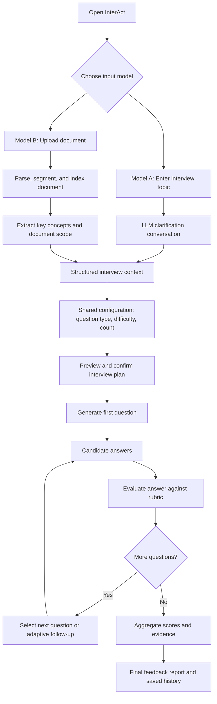
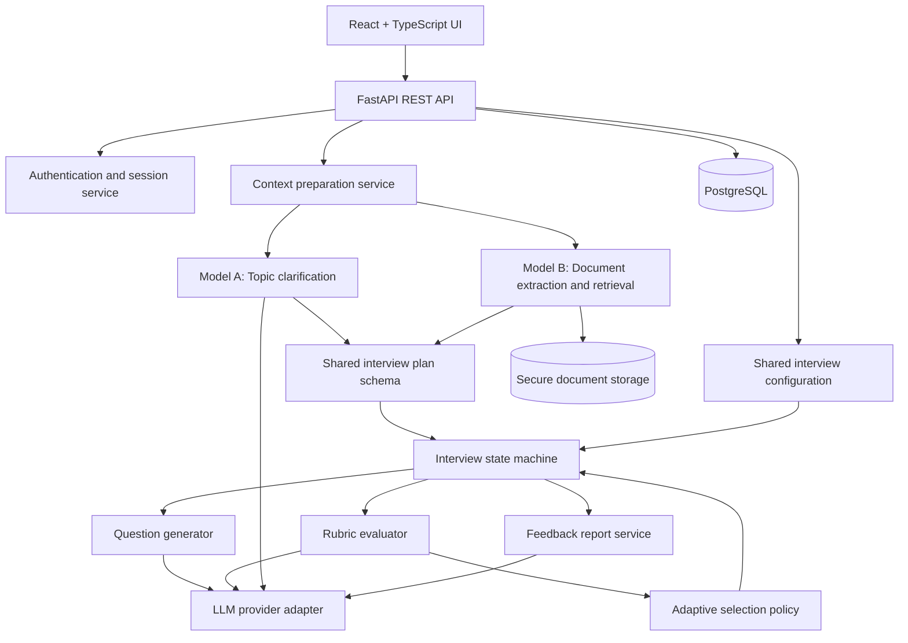
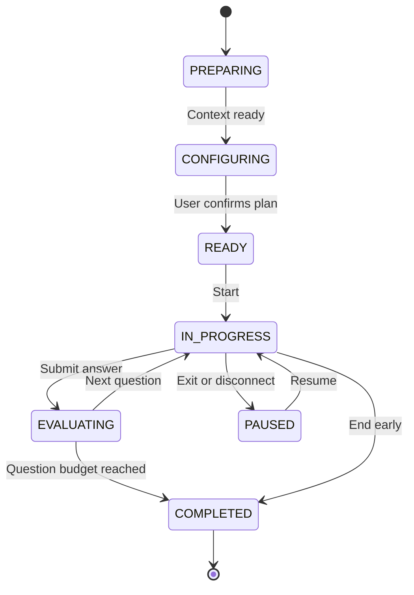

# InterAct

**An AI-powered, configurable interview practice platform with topic-based and document-grounded interviews, adaptive follow-ups, and evidence-based feedback.**

> **Project status:** Planned capstone — this README is a proposed technical specification, not documentation of an already implemented system.
>
> **Team:** 4 developers | **Target timeline:** 4 weeks | **Focus:** Applied AI/ML research + full-stack software engineering

## 1. Product overview
x
InterAct allows a user to prepare for an interview in **exactly two ways**:

- **Model A — Topic-Based Interview:** The user describes what they want to be interviewed on in natural language. An LLM conducts a short **pre-interview clarification conversation** to establish the topic boundaries, goals, experience level, and relevant subtopics.
- **Model B — Document-Based Interview:** The user uploads a supported document. The platform extracts and organizes its content, then creates an interview grounded in that document. The user can review the identified topics and adjust the scope before proceeding.

**Question-style selection is not a third model.** Both models lead into the same configuration screen, where the user chooses direct, conceptual, case-based, scenario-based, application/problem-solving, or mixed questions, along with difficulty and question count. Both models then use the **same interview engine, scoring pipeline, and reporting system**.

### Product objectives

1. Make interview preparation flexible for technical, academic, and general subjects.
2. Let users specify interview goals conversationally or through a source document.
3. Generate questions consistent with the chosen style and difficulty.
4. Adapt follow-up questions to prior responses while maintaining topic coverage.
5. Provide actionable, evidence-based feedback rather than unsupported scores.
6. Evaluate the system scientifically against a fixed-question baseline.

**Positioning:** InterAct is an interview *practice and formative assessment* tool, not a validated automated hiring system. It should not make employment decisions or infer personality, emotion, or employability from facial or vocal cues.

---

## 2. User experience and functional flow



### 2.1 Model A — Topic-based interview

**Example user prompt:**

> Interview me on machine learning, especially cross-validation, overfitting, and evaluating classification models. I'm preparing for an ML internship.

**Sequence:**

1. User enters a free-form topic/prompt.
2. Backend creates a draft interview session in `PREPARING` state.
3. Preparation LLM extracts tentative topic, subtopics, goal, and skill level.
4. LLM asks **only the necessary clarification questions** (e.g., target level, interview purpose, subtopic emphasis). User may skip optional questions.
5. User replies conversationally; backend updates a **structured interview context**, not just a raw chat transcript.
6. LLM summarizes the agreed scope and hands off to shared configuration.
7. User selects question style and other settings, previews the plan, and confirms.
8. Interview begins.

**Preparation chat rules:** Limit to approximately 2–4 useful clarifications; avoid repeated questions; permit edits to the proposed scope; never begin the interview without explicit user confirmation. The preparation LLM acts as a planner, not the interviewer.

### 2.2 Model B — Document-based interview

**Supported initial formats:** PDF, DOCX, PPTX, TXT. For a four-week MVP, prioritize text-based PDFs and TXT, then add DOCX/PPTX if time allows. Scanned PDFs require OCR and may be rejected in the MVP with a clear message.

**Sequence:**

1. User uploads a document.
2. Backend validates extension, MIME/content type, size, and extraction limits; stores it securely.
3. Document ingestion extracts text and available page/slide/section metadata.
4. System segments the text into retrievable chunks with source references.
5. LLM extracts topics, learning objectives, and candidate interview scope **from the source**.
6. UI shows a document summary and detected topics for user review.
7. User optionally selects chapters/sections or clarifies focus.
8. User proceeds to the **same shared interview configuration** used in Model A.
9. Question generator retrieves relevant source chunks and produces document-grounded questions with source references.
10. Interview begins and final feedback distinguishes **document-supported claims** from outside knowledge.

**Grounding requirements:** A generated document-based question must be traceable to a source chunk. Retain file ID and page/slide/section metadata where available. Do not invent citations. If source content is missing or insufficient, state the limitation and ask the user to broaden scope or upload a better source.

### 2.3 Shared interview configuration (both models)

| Setting | Choices / behavior |
|---|---|
| Question type | Direct/factual; conceptual; case-based; scenario-based; application/problem-solving; mixed |
| Difficulty | Beginner; intermediate; advanced |
| Question count | Suggested MVP: 5, 10, or 15 |
| Adaptive follow-ups | On by default; user may disable |
| Feedback timing | End-of-interview by default |
| Topic coverage | Display proposed competencies/subtopics before confirmation |
| Source constraint | In Model B, questions should be grounded in the uploaded document |

**Question types:**

- **Direct/factual:** “Define overfitting.”
- **Conceptual:** “Why can cross-validation provide a better estimate than one train/test split?”
- **Case-based:** “A model achieves 98% accuracy on a highly imbalanced dataset. Diagnose the result.”
- **Scenario-based:** “Your deployed model begins underperforming after a data pipeline change. What do you investigate?”
- **Application/problem-solving:** “Design an evaluation strategy for an imbalanced binary classifier.”
- **Mixed:** Selects across types using an explicit mix policy.

**Enforcement:** Store `question_type` in the session configuration and on every generated question. Validate question output against the requested style using schema checks and an optional lightweight LLM classifier. Regenerate or flag mismatches. A case-based question should include a concrete case; a scenario-based question should include a situation and decision constraints.

### 2.4 Live interview

1. The system presents **one question at a time**.
2. The user submits a text answer.
3. The evaluator returns structured scores, evidence from the answer, missing concepts, and uncertainty.
4. The interview state is updated with covered competencies, difficulty, question count, and recent performance.
5. The adaptive policy selects the next subtopic and question intent. The generator creates the next question within the **user-selected style**.
6. Repeat until the configured question budget is exhausted or the user ends the session.
7. Aggregate the rubric scores and generate the final report.

**Important:** Follow-up questions count toward the configured question budget unless the product explicitly offers a separate follow-up allowance. The MVP uses the same question budget in fixed and adaptive experiments.

### 2.5 Final feedback report

- Overall practice score (clearly labeled as a rubric-based estimate).
- Per-competency scores and coverage.
- Per-question response, score, explanation, and answer-grounded evidence.
- What the user answered correctly and what was missing.
- Suggested better-answer outline and areas to revise.
- For Model B: relevant source page/slide/section references where reliably available.
- Interview configuration, duration, and question history.
- Limitations/uncertainty notices when the answer or source does not support a confident assessment.

---

## 3. Proposed technical architecture

**Approach:** Modular monolith. A React frontend communicates with one FastAPI backend. The backend contains separate modules for ingestion, preparation, orchestration, generation, scoring, and reporting. PostgreSQL persists sessions and experiments. Avoid microservices and unnecessary multi-agent complexity during the four-week MVP.



### Suggested technology stack

| Component | Technology | Responsibility |
|---|---|---|
| Frontend | React + TypeScript + Tailwind CSS | Preparation chat, upload UI, configuration, interview, report |
| Backend | Python + FastAPI + Pydantic | API endpoints, validation, session lifecycle |
| Orchestration | Explicit Python state machine; optional LangGraph | Deterministic state transitions and conditional follow-ups |
| LLM | One hosted LLM behind an adapter | Clarification, extraction, generation, scoring, feedback |
| Database | PostgreSQL + SQLAlchemy + Alembic | Persistent session, answers, scores, research metadata |
| Document parsing | PyMuPDF/pypdf, python-docx, python-pptx | Source extraction with metadata |
| Retrieval | Initially lexical/full-text search; optional pgvector | Retrieve relevant document chunks |
| Tests | pytest, frontend tests, API integration tests | Reliability and regression coverage |
| Deployment | Docker Compose + suitable cloud hosting | Reproducible deployment |

### Why use a single shared interview engine?

The **input model only changes how context is prepared**. Once `InterviewContext` exists, both Model A and Model B share identical configuration, question generation, answer submission, scoring, and report code. This prevents duplicated logic and makes it easier to test question styles across both input models.

---

## 4. Core data contracts

The following are **illustrative proposed schemas**, not implemented interfaces.

### InterviewContext

```json
{
  "session_id": "uuid",
  "input_model": "TOPIC",
  "topic": "Machine Learning Model Evaluation",
  "goal": "ML internship practice",
  "level": "intermediate",
  "subtopics": ["cross-validation", "overfitting", "classification metrics"],
  "document_id": null,
  "source_references": []
}
```

For Model B, `input_model` is `DOCUMENT` and `document_id` identifies the uploaded source.

### InterviewConfig

```json
{
  "question_type": "CASE_BASED",
  "difficulty": "intermediate",
  "question_count": 10,
  "adaptive": true,
  "feedback_timing": "END"
}
```

Suggested question type enum: `DIRECT`, `CONCEPTUAL`, `CASE_BASED`, `SCENARIO_BASED`, `APPLICATION`, `MIXED`.

### GeneratedQuestion

```json
{
  "question_id": "uuid",
  "session_id": "uuid",
  "sequence": 1,
  "type": "CASE_BASED",
  "competency": "classification evaluation",
  "difficulty": "intermediate",
  "prompt": "A classifier has 98% accuracy but detects few positive cases. How would you evaluate it?",
  "rubric_id": "uuid",
  "source_chunk_ids": []
}
```

### AnswerEvaluation

```json
{
  "question_id": "uuid",
  "score": 3,
  "max_score": 5,
  "criteria": [
    {
      "name": "metric selection",
      "score": 2,
      "max_score": 3,
      "evidence_quote": "I would examine recall and precision",
      "reason": "Relevant metrics identified, but trade-offs were not explained"
    }
  ],
  "missing_concepts": ["precision-recall trade-off"],
  "insufficient_evidence": false
}
```

**Validation:** Ensure scores fall within rubric bounds; evidence quotes must be verifiable substrings of the submitted answer or explicitly marked as paraphrases; do not present LLM-generated rationales as observed candidate statements.

---

## 5. Interview state machine



**Backend rules:**

- A session must not start until a valid `InterviewContext` and `InterviewConfig` are confirmed.
- Only one unanswered active question should exist per session.
- Answer submission should be idempotent to avoid duplicate questions or scores.
- Persist state before acknowledging completed operations.
- On LLM errors, retry safely within limits; do not silently fabricate scores.
- Keep raw model output separate from validated structured data.
- Uploaded document text and user answers are untrusted inputs; they must not override system instructions or rubric rules.

### Adaptive policy (MVP)

Use a transparent rule-based policy instead of training a separate model:

1. Track coverage of each planned competency.
2. Evaluate the latest answer using the same rubric as the fixed baseline.
3. If evidence is incomplete and follow-ups are enabled, select a clarifying/deeper question within the same competency.
4. Otherwise, move to the least-covered planned competency.
5. Maintain the selected question style and difficulty bounds.
6. Respect the question budget and avoid repeating questions.

Keep **fixed-question mode** available internally for controlled research comparisons. Adaptive mode is a user-facing configuration option, not a third input model.

---

## 6. Proposed API endpoints

| Method | Endpoint | Purpose |
|---|---|---|
| `POST` | `/api/sessions` | Create draft session for `TOPIC` or `DOCUMENT` |
| `POST` | `/api/sessions/{id}/prepare/message` | Exchange Model A clarification messages |
| `POST` | `/api/documents` | Upload and validate a document |
| `GET` | `/api/documents/{id}/summary` | Return extracted topics and source summary |
| `PUT` | `/api/sessions/{id}/context` | Update/confirm prepared scope |
| `PUT` | `/api/sessions/{id}/config` | Set common question style, difficulty, and count |
| `POST` | `/api/sessions/{id}/start` | Confirm and begin interview |
| `GET` | `/api/sessions/{id}/current-question` | Fetch active question |
| `POST` | `/api/sessions/{id}/answers` | Submit answer and trigger evaluation |
| `POST` | `/api/sessions/{id}/finish` | End session and generate report |
| `GET` | `/api/sessions/{id}/report` | Fetch report |
| `GET` | `/api/sessions` | List user's interview history |

All session/document endpoints must authorize access to the resource owner. For long LLM operations, return a job/status identifier or use an appropriate asynchronous request pattern rather than blocking indefinitely.

---

## 7. Proposed database entities

| Entity | Important fields |
|---|---|
| `users` | id, authentication identifier, created_at |
| `documents` | id, owner_id, filename, storage_key, status, created_at |
| `document_chunks` | id, document_id, text, page/slide/section reference, chunk_index |
| `sessions` | id, user_id, input_model, state, context_json, config_json, created_at |
| `preparation_messages` | id, session_id, role, content, created_at |
| `questions` | id, session_id, sequence, type, competency, prompt, rubric_id, source_refs |
| `answers` | id, question_id, session_id, text, submitted_at |
| `evaluations` | id, answer_id, scores_json, evidence_json, evaluator_version |
| `reports` | id, session_id, summary_json, generated_at |
| `experiment_runs` | id, model_version, prompt_version, rubric_version, dataset_version, metrics_json |

Store minimal personal information. Set retention/deletion rules for uploaded files and answers. Research datasets should be synthetic or explicitly consented and de-identified where appropriate.

---

## 8. AI/ML research and evaluation

### Primary research question

**Does adaptive question selection improve question relevance and competency coverage over fixed-question interviewing, while maintaining acceptable score agreement with human ratings?**

### Experimental design

- **Baseline:** fixed sequence of questions.
- **Treatment:** adaptive follow-up selection.
- **Controlled variables:** same LLM provider/model version, rubric, target topic, question-style setting, difficulty, and question budget.
- **Dataset target:** approximately 60–100 answer instances if feasible, with independently human-rated examples; reduce target rather than compromise annotation quality.
- **Metrics:** human-vs-AI score MAE, appropriate ordinal agreement (e.g., weighted Cohen's kappa), question relevance, competency coverage, evidence support rate, repeat-score variance, latency, and cost.
- **Document-grounding test:** human-check whether generated questions and cited source references are actually supported by uploaded content.
- **Reporting:** publish sample sizes, uncertainty, limitations, and failures, not only favorable examples.

Do not claim that the adaptive system is superior until experimental results support that conclusion. Maintain separate development and evaluation examples to reduce overfitting to the benchmark.

---

## 9. Four-week implementation roadmap

| Week | Focus | Exit criteria |
|---|---|---|
| **1** | Set up repo/API/database; build topic preparation conversation; basic document ingestion; shared config | Both models produce a confirmed interview context and configuration |
| **2** | Implement question types, fixed and adaptive engine, answer evaluation, persistence, report UI | Full end-to-end interview works in both models |
| **3** | Improve document grounding; human annotation; benchmark fixed vs adaptive; test style compliance | Reproducible initial evaluation results and error analysis |
| **4** | Reliability/security tests, deployment, final experiments, technical report, README and demo | Deployed MVP with documented research results |

**Scope protection:** Text-only interview is the MVP. Voice, video, emotion detection, arbitrary code execution, and custom model training are out of scope for the four-week release.

### Team allocation

| Owner | Responsibility |
|---|---|
| **Member 1 — AI planning & orchestration** | Model A clarification, interview context, question generation, question-style enforcement, adaptive policy |
| **Member 2 — Document intelligence & research** | Model B parsing/grounding, scoring rubric, dataset, human evaluation, experiment analysis |
| **Member 3 — Backend & data** | FastAPI, PostgreSQL, APIs, authentication, session state, persistence, backend tests |
| **Member 4 — Frontend & deployment** | React UX, upload/chat/config/interview/report screens, frontend tests, Docker and hosting |

All members collaborate on API contracts, integration, end-to-end tests, and documentation.

---

## 10. Acceptance criteria

### Product

- [ ] Model A supports free-form topic input and short, skippable LLM clarification.
- [ ] Model B accepts at least text-based PDFs and extracts traceable source content.
- [ ] Both models converge into one shared question-style configuration screen.
- [ ] Direct, conceptual, case-based, scenario-based, application, and mixed questions are supported.
- [ ] User confirms the interview plan before the first question.
- [ ] Interview progresses one question at a time with persisted answers.
- [ ] Adaptive follow-ups preserve the selected question style and topic scope.
- [ ] Final report includes scores, answer evidence, and actionable suggestions.

### Engineering and research

- [ ] Sessions resume safely and reject duplicate answer submissions.
- [ ] API and integration tests cover the critical interview journey.
- [ ] Document access is authorized; secrets and uploads are protected.
- [ ] Fixed and adaptive experiments use documented comparable settings.
- [ ] Human-rated benchmark and evaluation scripts are reproducible.
- [ ] App is deployed with setup instructions and a recorded fallback demo.
- [ ] Final report clearly distinguishes verified results from limitations.

---

## 11. Repository layout (proposed)

```text
interact/
├── frontend/
│   └── src/
│       ├── pages/           # Input, preparation, configuration, interview, report
│       ├── components/
│       └── api/
├── backend/
│   ├── app/
│   │   ├── api/             # REST routes
│   │   ├── schemas/         # Pydantic contracts
│   │   ├── models/          # Database entities
│   │   ├── services/
│   │   │   ├── preparation.py
│   │   │   ├── document_ingestion.py
│   │   │   ├── question_generation.py
│   │   │   ├── adaptive_policy.py
│   │   │   ├── evaluation.py
│   │   │   └── reporting.py
│   │   └── core/            # Auth, configuration, provider adapter
│   └── tests/
├── research/
│   ├── datasets/
│   ├── annotation_guidelines.md
│   ├── experiments/
│   └── analysis/
├── docs/
│   ├── architecture.md
│   └── api.md
├── docker-compose.yml
└── README.md
```

## 12. Demo scenarios

**Scenario A — Topic-based:** “Interview me on operating systems for a software engineering internship.” The AI clarifies focus, user selects scenario-based questions, and the interviewer asks situational OS questions followed by targeted follow-ups.

**Scenario B — Document-based:** User uploads a lecture PDF on database normalization, selects case-based questions, and receives questions tied to the uploaded material, followed by an evidence-based feedback report.

**Scenario C — Research demonstration:** Run the same competency plan in fixed and adaptive modes; show question histories, coverage differences, score agreement, and limitations from the benchmark.

---

## 13. Future extensions (not MVP commitments)

- Voice input/output and speech transcription.
- Coding interviews with isolated execution and automated test cases.
- User-selectable feedback timing and detailed progress trends.
- Multilingual interview support.
- Larger-scale controlled studies with more participants and domains.

---

## 14. Contributing and status

This repository is intended for a four-person academic capstone. Contributors should agree on data contracts and interface ownership before implementation. Use feature branches, pull-request reviews, automated tests, and versioned research configurations.

**Current state:** Specification finalized; implementation and benchmark results pending. Replace this status section with verified setup commands, screenshots, demo URL, actual experiment results, and individual contributions as development progresses.

## License

To be decided by the team before public release.
